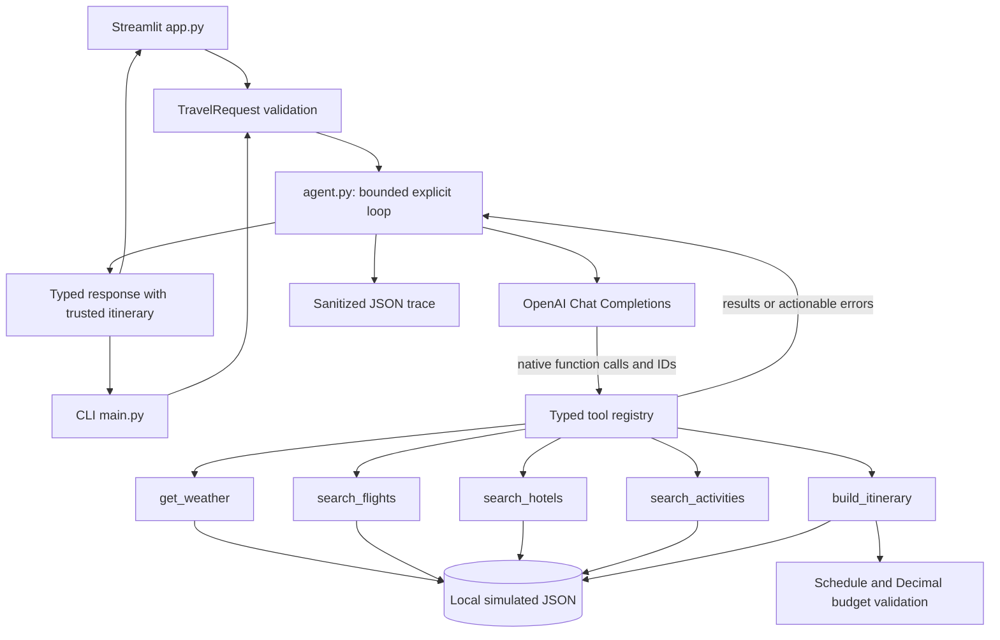

# TripPilot AI

**Your intelligent travel planning assistant**

University project for **Unicorn University — AI for Software Developers, Homework 3: Agentic Application**, implementing **Option A: Travel-Planner Agent**.

TripPilot uses a real OpenAI model to choose tools, inspect results, recover from failures and propose a day-by-day plan. Python validates the plan and calculates every cost. All travel information is **deterministic, simulated educational data**. Nothing is booked and no real-time information is provided.

## Features

- English Streamlit interface and independent JSON-input CLI.
- Five typed tools, an explicit manual agent loop and native function calling; no orchestration framework.
- Pydantic validation for requests, arguments, results, itineraries and final responses.
- Group budgets in EUR, ID-based pricing, meal coverage, weather, flight buffers, pace and schedule validation.
- Recoverable tool errors, bounded API retries, repeat-call limits and clean termination.
- Sanitized observable JSON traces and downloadable itinerary/trace files.
- Searchable departure and destination fields with 168 local city suggestions and country labels; custom city names, including Unicode, remain supported. Rome, Paris, Barcelona, Vienna and Amsterdam retain their curated simulated fixtures; other routes/cities use clearly labeled generic synthetic templates.

## Screenshots

Place genuine screenshots here after running the app:

1. `docs/screenshots/request-form.png` — form and simulation disclaimer (placeholder).
2. `docs/screenshots/rome-itinerary.png` — successful metrics and daily schedule (placeholder).
3. `docs/screenshots/paris-recovery.png` — actual hotel failure, revised search and vegetarian meals (placeholder).
4. `docs/screenshots/budget-trace.png` — budget chart and execution trace (placeholder).

## Stack and architecture

Python 3.11+, OpenAI Python SDK, Pydantic 2, Streamlit, python-dotenv, JSON and pytest. Verification used the workspace Python 3.14 environment; other Python versions have not been executed here. `requirements.txt` specifies major-version ranges; `requirements-tested.txt` records installed versions.



### Explicit agent loop

Read `TravelAgent._run()` in `agent.py`. Each iteration calls `client.chat.completions.create()` with the conversation, five function schemas and a native strict JSON schema for the final decision. The model chooses tool names and arguments. Python preserves the assistant tool-call message, executes validated calls and appends each result with its matching `tool_call_id`. The next model call receives results, failures and suggestions.

There is **no fixed sequence of five calls** or prebuilt successful itinerary in the application. Parallel function calling is disabled for readability; the loop still preserves all calls if several are returned. Success requires all five tools to have succeeded and the builder to have validated the exact original request. The model cannot increase the user's budget or change dates in the builder. Python attaches the builder result rather than accepting model-invented prices.

Final statuses: `success`, `needs_clarification`, `infeasible`, `error`, `iteration_limit`. Default: 15 model iterations, maximum configuration 50. Identical calls execute at most twice; a tool is blocked after four failures. Network/timeouts/rate limits receive at most three API attempts with short backoff; SDK automatic retries are disabled. Authentication and other API errors terminate immediately. Unexpected runtime errors also finalize a sanitized trace.

The default `gpt-4.1-mini` supports function calling and structured outputs according to its [official model documentation](https://developers.openai.com/api/docs/models/gpt-4.1-mini). Implementation follows the [function-calling guide](https://developers.openai.com/api/docs/guides/function-calling) and [structured-output guide](https://developers.openai.com/api/docs/guides/structured-outputs?api-mode=chat). Account access and paid API execution remain unverified until a key is supplied. Change `OPENAI_MODEL` only to a model supporting both Chat Completions function calling and JSON-schema responses.

### Five tools

| Tool | Input and behavior |
| --- | --- |
| `get_weather` | Destination and inclusive dates; seasonal temperature, rain, conditions and indoor/outdoor advice. |
| `search_flights` | Any departure/destination city labels, round-trip dates, travelers and optional **group total** cap. Returns local outbound/return times and individual/group costs. |
| `search_hotels` | Destination, check-in/out, travelers, optional **combined nightly** cap and type. Hotel/budget rates are per room (capacity two); hostel rates are per bed. Nights = checkout − checkin. |
| `search_activities` | Interests, all dietary restrictions, environment and optional **per-person** cap. Returns attractions plus compatible meals; meals remain included regardless of interests/environment. |
| `build_itinerary` | Original request, flight/hotel IDs and daily activity IDs/times/meal labels. Resolves prices from local data, checks weather and builds a valid itinerary or actionable errors. |

The registry exposes Pydantic-generated JSON schemas and rejects unknown tools, malformed JSON, extra fields and invalid argument values. Tools return typed `ToolResult` envelopes with typed records or a `ToolError` containing code, message and suggestions. `data_source` is always `simulated`.

### Structured output and budget rules

The LLM's native structured response is a small `FinalDecision` (`status`, `message`). The public `FinalResponse` contains `status`, `message`, `data_source` and an `itinerary` object on success. The nested itinerary contains:

- `trip_summary`, `selected_flights`, `selected_accommodation`.
- `daily_itinerary` with weather, time slots, typed activity/meal records, daily costs and advice.
- `budget_breakdown`, `weather_summary`, recommendations and warnings.

Arithmetic uses `Decimal` before JSON number conversion. Budget covers **all** travelers. Flights/accommodation are charged once. Meals/attractions multiply by travelers; local transport is EUR 5 per traveler per calendar day, including simulated airport transfers. Daily costs include meals, attractions and transport, with flights/accommodation added once at trip level. The budget model also validates its component sum.

The builder enforces every trip date exactly once and at least one attraction per day:

- Arrival +90 minutes and return departure −120 minutes; other days 08:00–22:00 local time.
- Catalogue durations, ordered slots and 15-minute transfer gaps.
- Breakfast/lunch/dinner when the on-site window permits, valid meal times and all dietary restrictions.
- Rain probability ≥50% requires indoor attractions.
- Relaxed: maximum 2 attractions/180 minutes; moderate: 4/360; intensive: 6/540. Meals are additional.
- Trusted destination-specific IDs and a total within the original budget.

### Error handling and recovery demonstration

Ordinary planning starts with realistic searches and never deliberately triggers a hotel failure. The UI shows one current progress message that updates in place; technical errors, arguments and full results remain available in the expandable trace.

The course recovery demonstration is explicitly opt-in:

```bash
python main.py --input examples/paris.json --demonstrate-recovery --output results/paris.json
```

That flag adds the documented prompt heuristic: for a budget below EUR 125 per traveler per day, first explore hotel accommodation at EUR 30/night. No such hotel exists in the data, so the model receives `no_results` and independently revises its search. This behavior is isolated from the ordinary web and CLI experience. Genuine historical Paris traces below were produced with that same heuristic enabled before it was moved to the explicit demonstration flag.

### Early budget screening

`planning.py` computes a conservative catalogue cost lower bound before any paid model request. It uses group flight costs, required room/bed counts and nights, compatible mandatory meals, one cheapest weather-compatible attraction per day, and transport. Shared meal and airport-time rules live in `scheduling.py`. If even these costs exceed the budget, the agent returns `infeasible` immediately with a typed `budget_estimate` and a saved trace. The UI explains the minimum required, available budget and shortfall with a category breakdown. Infeasibility is a planning outcome, not an application error.

For example, Vienna on 24–29 November 2026 for two travelers requires at least EUR 712: flights 170, hostel 230, meals 252 and transport 60. A EUR 600 request is rejected with a EUR 112 gap and zero API calls. Regression tests freeze the current date to reproduce this historical example.

Passing the screen does not prove schedule feasibility. Interests and detailed scheduling are deliberately relaxed for a safe lower bound; the real LLM still selects all five tools and the builder validates the complete plan. The estimate is not a ready itinerary and cannot be returned as a successful plan. Error responses distinguish invalid input, API/configuration failures and exhausted planning attempts.

## Project structure

```text
trip-pilot-ai/
├── app.py, main.py             # Streamlit and CLI
├── agent.py, prompts.py        # Manual loop and instructions
├── schemas.py, config.py       # Contracts and settings
├── planning.py, scheduling.py  # Cost lower bound and shared time rules
├── tracing.py                 # Sanitized traces
├── tools/                     # Five tools, helpers, registry
├── data/                      # Curated fixtures, generic templates and city suggestions
├── examples/                  # Rome and Paris inputs
├── traces/                    # Actual runtime traces, including failures
├── tests/                     # Mocked agent, tools, budget, schemas, UI
│   └── artifacts/             # Clearly labeled mocked reference traces
├── .streamlit/config.toml     # Light teal theme
├── .env.example, .gitignore
├── requirements.txt, requirements-tested.txt
├── VERIFICATION.md
└── README.md
```

## Installation

From this directory on macOS/Linux:

```bash
python3 -m venv .venv
source .venv/bin/activate
python -m pip install -r requirements.txt
cp .env.example .env
```

Windows PowerShell:

```powershell
py -3 -m venv .venv
.venv\Scripts\Activate.ps1
python -m pip install -r requirements.txt
Copy-Item .env.example .env
```

Only copy the example when `.env` does not already exist. Edit `.env` locally:

```dotenv
OPENAI_API_KEY=your-own-api-key
OPENAI_MODEL=gpt-4.1-mini
MAX_AGENT_ITERATIONS=15
```

Existing environment variables take precedence over `.env`. Configuration loads the file beside `config.py`, independent of launch directory. Never commit it. Virtual environments, generated results, IDE caches and `.env` are ignored; demonstration traces remain eligible for version control. API credentials are never shown in the interface.

For the already-installed workspace environment, use `source ../.venv/bin/activate` from this project instead of creating another environment.

## Launch Streamlit

```bash
streamlit run app.py
```

Open the printed URL (normally http://localhost:8501), enter a request, then select **Generate Travel Plan**. One compact progress message updates during execution; detailed observable actions are available in the execution trace. Results persist across downloads. Tabs show itinerary, flights/accommodation, weather and budget. Download the final JSON and sanitized trace.

## CLI and real demonstrations

```bash
python main.py --input examples/rome.json --output results/rome.json
python main.py --input examples/paris.json --demonstrate-recovery --output results/paris.json
```

The CLI prints itinerary and budget and writes the final JSON plus timestamped trace. Exit codes: 0 success, 2 invalid/missing input, 1 other failures. Valid JSON with invalid fields produces a clarification trace; unreadable or non-JSON files exit before starting the agent.

**Two genuine successful OpenAI demonstrations are included**, executed with `gpt-4.1-mini` on 24 November 2026:

| Scenario | Estimated total | Budget | Genuine trace |
| --- | --- | --- | --- |
| Rome | EUR 341 | EUR 600 | `traces/20261124T182657_e85c4d77-3850-4df6-8ad1-af5326f86d7f.json` |
| Paris, hotel search recovery | EUR 209 | EUR 350 | `traces/20261124T182658_1bc27b17-5ca7-4ca0-b721-f697a70fcf60.json` |

Both runs used all five tools and passed Python budget validation. Paris first searched for a hotel at EUR 30/night, received `no_results`, then independently selected a hostel and vegetarian meals. These are real model executions over simulated travel data. No accommodation or tickets were actually booked, regardless of conversational wording in the model's response.

To reproduce, configure your own key, run both commands above and inspect the printed trace files:

1. Confirm `execution_mode=real_llm`, `final_status=success`, all five tools and `budget_validation.valid=true`.
2. For Paris, confirm hotel `no_results`, a changed subsequent search, vegetarian meals and builder success.
3. If recovery is absent, inspect the actual calls; transparently adjust the documented prompt heuristic or data, run again and retain genuine trace history.
4. Review sanitized traces for personal information before including the two successful files in your submission.

`tests/artifacts/rome_mocked.json` and `paris_recovery_mocked.json` contain full successful **mocked reference runs**, labeled `mocked_unit_test`. They demonstrate dispatch, validation and recovery, and **do not fulfill the genuine LLM trace requirement**. Any missing-key trace in `traces/` also does not fulfill it.

### Example input/output

`examples/rome.json`:

```json
{
  "origin": "Prague", "destination": "Rome",
  "start_date": "2027-04-10", "end_date": "2027-04-13",
  "budget": 600, "travelers": 1, "pace": "moderate",
  "interests": ["architecture", "museums", "history", "local food"],
  "dietary_preferences": []
}
```

Unrestricted diet uses `[]`; restrictions are `vegetarian`, `vegan`, `gluten-free`, and may be combined. Supported input: 1–14 calendar days during 2026–2035, starting today or later, 1–20 travelers and a positive finite budget. The UI prevents past start/end dates; CLI and agent validation reject past departure dates before any paid API call. Both city fields accept free text. Identical city labels after case/whitespace normalization are rejected. City names are labels, not geocoded or checked against a directory; English names are preferred for matching the curated fixtures. One-day trips have zero lodging nights.

Abbreviated illustrative output, not a real API execution:

```json
{
  "status": "success",
  "message": "Your simulated itinerary is validated.",
  "itinerary": {
    "trip_summary": {"origin": "Prague", "destination": "Rome"},
    "budget_breakdown": {"flights": 70, "accommodation": 69, "food": 84,
      "activities": 0, "local_transport": 20, "total": 243, "remaining_budget": 357}
  },
  "data_source": "simulated"
}
```

Required detail fields are omitted in this illustration; the complete mocked JSON shows the full schema. Fixture budgets are Rome EUR 243 and Paris EUR 203. Real model choices can differ.

## Execution traces and security

`tracing.py` writes timestamp/UUID JSON files in `traces/`: request, configured model, execution mode, iteration messages, call IDs, tool arguments/results/errors, replanning, timestamps/durations, token usage when available, final response/status and successful budget validation. Budget validation is `null` on failure. Hidden chain-of-thought is neither requested nor stored.

Sensitive field names, known environment keys, `sk-…` values and bearer credentials are recursively redacted. API errors record exception classes rather than raw server bodies; headers are not logged. Traces contain trip preferences, so review before sharing. `real_llm` describes the real-client path, including preflight failures; inspect iterations/status to determine whether an API call succeeded.

## Tests and verification

```bash
python -m pytest -v
```

Tests use scripted SDK-shaped completions without paid calls. They cover input/schema validation; all tools; IDs/arguments; weather/diets; hostel/room/group math; budgets and schedule constraints; tool-call ID preservation; full success and hotel recovery; request tampering; retries, repetition and iteration limits; clean termination; trace generation/redaction; and Streamlit rendering. Temporary traces stay outside the production trace directory.

Final result: **109 tests passed**. Ruff lint and formatting checks also passed. See `VERIFICATION.md` for actual results and startup checks. Rendering works without a key; generating real plans requires a key and network.

## Limitations and future improvements

All schedules, rates, availability, capacities, restaurants, ratings and seasonal weather are invented. Flights use a simplified same-day simulation timeline. Generic routes do not model geographic distance, real flight durations, overnight arrivals, date-line crossings or time-zone offsets; their times must not be interpreted as real flight schedules. There are no real opening hours, baggage extras, routing distances, accessibility checks or booking integrations. Restaurant compatibility is illustrative and cannot be relied on for real allergies. Rain handling conservatively requires indoor attractions. The simulated free community gallery does not claim that any real museum is free.

Future work could add verified API adapters, routing, opening hours, richer availability constraints and model evaluations, while retaining independent price/budget checks. Validated success does not prove optimality; an LLM can also conclude infeasibility prematurely.

## Assignment checklist

- [x] Native OpenAI tools and explicit inspectable agent loop.
- [x] Five independent typed tools and structured output.
- [x] Curated data for five destinations and Prague departures, plus generic synthetic fixtures for arbitrary city labels.
- [x] Python arithmetic and itinerary validation.
- [x] Feedback, replanning, bounded retries and termination.
- [x] Streamlit, CLI, examples and automatic sanitized traces.
- [x] Mocked automated tests, architecture and setup instructions.
- [x] Git repository connected to `https://github.com/02ionova/TripPilot`; updates committed and pushed with user authorization.
- [x] Two genuine successful LLM traces, including Paris recovery.
- [ ] Real screenshots — placeholders listed above.

## Troubleshooting model access

A 404 `NotFoundError` means the configured model was not found or is unavailable to the API project. The observed failed run used `gpt-5.1-mini`; the verified working configuration uses `OPENAI_MODEL=gpt-4.1-mini`. Update your local `.env`, stop Streamlit with Ctrl+C, then launch `streamlit run app.py` again. Existing environment variables take precedence, so also check any exported `OPENAI_MODEL` value. Authentication, permission, incompatible-request and missing-model failures now produce separate actionable messages; traces retain the exception class and HTTP status without logging raw API response bodies.

## Repository workflow

Changes are committed locally and pushed to the user-designated `origin` at `https://github.com/02ionova/TripPilot`. Before committing, run tests, inspect the diff and review any selected trace files for credentials and personal data. `.env` stays ignored. Genuine demonstration traces are deliberately tracked; incidental local execution traces do not need to be included in every commit.

## Arbitrary departure and destination cities

Type a city name in **Departure city** or **Destination** to filter the suggestions. Each suggestion includes its country. Choose a suggestion or add any unlisted city as a new option; the list is not a restriction on supported input. Unicode letters, spaces, accents and punctuation in city names are supported; blanks, labels without letters, excessive length and identical departure/destination labels are rejected. Transliteration, aliases and city-country disambiguation are not resolved.

`tools/catalog.py` preserves original Prague-to-curated-city flight IDs/rates. Other routes receive deterministic synthetic flight IDs/prices derived from the normalized origin/destination pair. Unknown destinations use `data/generic_templates.json` for accommodation, 12 generic attractions, diet-compatible meals and neutral fictional weather. Generic names deliberately do not claim that real venues or landmarks exist. SHA-256-derived IDs are consistent across processes and destination-specific, so the builder and budget precheck resolve exactly the same records as search tools.

The final itinerary warns when routes, venues or climate profiles use generic templates. This supports the educational agent flow for arbitrary inputs; it does not provide verified worldwide travel data. Genuine five-tool verification: Berlin to Lisbon, EUR 338 total under EUR 600, vegetarian meals. Reproduce with:

```bash
python main.py --input examples/berlin_lisbon.json --output results/berlin_lisbon.json
```

## City search and explicit submission

The city fields use Streamlit searchable selectors with `accept_new_options=True`. `data/cities.json` supplies 168 offline suggestions, displayed as city and country; the agent receives only the city label. `city_suggestions.py` loads these labels without geocoding, network requests or LLM calls. The suggestion list is a convenience, not a complete world directory, and unlisted city names can still be entered.

The request form explicitly sets `enter_to_submit=False`: Enter can confirm a city selection but does not start planning. Generate a plan only with **Generate Travel Plan**. The implementation uses Streamlit's [documented form submission setting](https://docs.streamlit.io/develop/api-reference/execution-flow/st.form) and [searchable selector with new options](https://docs.streamlit.io/develop/api-reference/widgets/st.selectbox). Streamlit 1.49 or later is required; the installed/tested version is 1.67.0.
