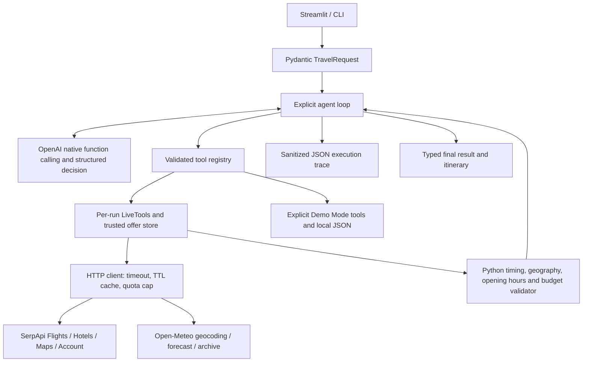

# TripPilot AI

**Your intelligent travel planning assistant**

Unicorn University — **AI for Software Developers, Homework 3: Agentic Application**, Option A: Travel-Planner Agent.

TripPilot is a Python/OpenAI tool-calling agent with a Streamlit interface and independent CLI. In **Live Mode (default)** it searches external providers for flights, accommodation, attractions, restaurants and weather. The model chooses its tools and alternatives; Python schedules visits, resolves trusted offer IDs and validates the total estimated budget. The application does not make bookings.

Travel information is retrieved from external data providers. Prices and availability may change. Estimated expenses are clearly marked.

## Features and screenshots

- Arbitrary departure/destination city labels, searchable offline suggestions and country disambiguation.
- Round-trip flights with complete outbound/return segments; real hotel quotes, source links and photos when supplied.
- Real places, addresses, coordinates, ratings, restaurant dietary indications and opening hours when available.
- Forecasts within the supported horizon; clearly labeled historical climate estimates for distant dates.
- Day-by-day schedule, geographic transfer allowances, required meals, pace/weather checks and group budget arithmetic.
- Bounded retries, replanning, provider caching/quota limits, sanitized execution traces automatically saved to disk.
- Explicit Demo Mode retains the original simulated tools for teaching and offline provider tests. It still needs OpenAI for interactive agent runs.

Screenshot placeholders (capture the actual running application):

| Screenshot | Suggested content |
| --- | --- |
| Input form | Live Mode, country-qualified cities, dates and preferences |
| Completed plan | Daily itinerary, actual venues, budget metrics and cost labels |
| Flights and hotel | Round-trip segments, hotel photo and source links |
| Recovery | Paris trace showing restrictive hotel search and successful broader search |

## Stack and architecture

Python 3.11+, OpenAI Python SDK, Pydantic, Streamlit, python-dotenv, httpx, SQLite/JSON and pytest. No orchestration framework.



### Explicit agent loop

The `for iteration ...` loop in `agent.py` calls `client.chat.completions.create` with native function definitions and a strict JSON-schema final decision. It preserves each assistant tool-call message, call ID and corresponding tool result. The model independently chooses the tool, arguments, searches, selected flight/hotel/attraction IDs and revisions. There is no fixed sequence of API calls.

Each result or structured error is appended to the conversation. The model may broaden hotel filters, search other venues, explore another outbound flight's return options, or revise the itinerary after budget/timing errors. Repeated identical calls, tool failures, transient retries and total iterations are bounded. Terminal statuses are `success`, `needs_clarification`, `infeasible`, `error`, and `iteration_limit`.

A successful response requires all six Live tools and a successful builder result. Python copies the validated builder result into the final response; model-generated prices or a final text claim cannot establish success. Native structured output constrains the final decision, while detailed Pydantic models validate inputs, offers, tool results and the final itinerary.

The live builder defaults to `auto_schedule=true`: the model selects retrieved attractions for each date, while a bounded Python constraint search places those visits and meals from the retrieved restaurant pool. It uses local flight arrival/departure times, opening intervals and estimated transfers. This mechanical scheduling step neither retrieves fictional places nor replaces the agent's tool/replanning decisions. `auto_schedule=false` validates proposed times strictly. The builder returns actionable errors for infeasible selections; the agent must change them.

### Tools and external APIs

| Tool | Source | Behavior |
| --- | --- | --- |
| `get_weather` | Open-Meteo | Geocode; daily min/max temperature, wind, weather code and forecast rain probability. Outside the 16-day horizon, comparable dates from three completed seasons are averaged and labeled **Historical climate estimate**. Historical wet-day frequency is not a predicted rain probability. |
| `search_flights` | SerpApi Google Flights + autocomplete | Resolve city/airport IDs; initial round-trip outbound search, then `departure_token` return selection. Only complete paired offers with usable prices/times are returned. The return-stage quote is the complete party round-trip price; the outbound-stage price is never added to it. |
| `search_hotels` | SerpApi Google Hotels | Date/guest-specific quotes, total/nightly rates, tax information, ratings, photos, location and links. Distinguishes period totals from nightly rates; missing usable prices return an error. |
| `search_activities` | SerpApi Google Maps | Bulk search real attractions by interests/query; preserve addresses, coordinates, ratings, hours and sources. Missing admission prices receive a labeled estimate, never an invented confirmed ticket price. |
| `search_restaurants` | SerpApi Google Maps | Bulk restaurant/cafe searches with requested diets and optional geographic bias. Supports vegetarian, vegan, gluten-free, halal and no restrictions. Provider indications are not dietary certification. |
| `build_itinerary` | Python, no HTTP | Resolve only IDs retrieved for this request, schedule and validate every date, pace, meals, known opening hours, weather, transfer gaps and total party costs. Return feedback for replanning. |

Official API references: [Flights](https://serpapi.com/google-flights-api), [flight results and return tokens](https://serpapi.com/google-flights-results), [autocomplete](https://serpapi.com/google-flights-autocomplete-api), [Hotels](https://serpapi.com/google-hotels-api), [Maps](https://serpapi.com/google-maps-api), [Search API](https://serpapi.com/search-api), [Account API](https://serpapi.com/account-api), [Open-Meteo forecast](https://open-meteo.com/en/docs), [geocoding](https://open-meteo.com/en/docs/geocoding-api), [historical weather](https://open-meteo.com/en/docs/historical-weather-api).

## Installation and configuration

From the repository directory on macOS/Linux:

```bash
python3 -m venv .venv
source .venv/bin/activate
python -m pip install -r requirements.txt
cp .env.example .env
```

Windows PowerShell:

```powershell
py -3 -m venv .venv
.venv\Scripts\Activate.ps1
python -m pip install -r requirements.txt
Copy-Item .env.example .env
```

Only copy `.env.example` if `.env` does not already exist. Edit your own `.env`:

```env
OPENAI_API_KEY=
OPENAI_MODEL=gpt-4.1-mini
SERPAPI_API_KEY=
MAX_AGENT_ITERATIONS=15
MAX_SERPAPI_REQUESTS_PER_RUN=15
DATA_MODE=live
```

Create/sign in to a [SerpApi account](https://serpapi.com/users/sign_up), then copy the API key from the private dashboard into `SERPAPI_API_KEY`. The same key is used for all SerpApi engines. No new subscription or paid plan is enabled by this application. Open-Meteo needs no key for its free noncommercial API; OpenAI usage is billed separately by OpenAI.

`gpt-4.1-mini` was verified with the installed OpenAI 2.x SDK using Chat Completions function calling and JSON-schema structured output. A replacement model must support both and be accessible to your OpenAI API project. Existing exported environment variables take precedence over `.env`. Restart Streamlit after changing keys/settings. Never commit `.env`.

### Launch the web application

```bash
streamlit run app.py
```

Open the displayed localhost URL. Choose Live Mode, enter cities (prefer **City, Country**) and future dates, budget for **all** travelers, pace, interests and diets. Planning starts only with **Generate Travel Plan**; Enter can select a city but does not submit the form. Country-qualified suggestions are passed to providers. Missing/invalid keys produce explicit errors, never an automatic simulation fallback.

Results show the daily itinerary, retrieved flight/hotel details, source timestamps, ratings, estimated transfer notes, categorized budget and request counters. Observable planning progress is displayed during generation. Technical logs and JSON export buttons are hidden from the web interface; full execution traces are still automatically saved in `traces/`, and the CLI saves final JSON results. Switching modes clears the previous result.

### CLI and examples

```bash
python main.py --mode live --input examples/live_rome.json --output results/live_rome.json
python main.py --mode live --input examples/live_paris.json --demonstrate-recovery --output results/live_paris.json
```

The Live examples reproduce the inputs of actual successful runs on 24 November 2026. **Update their dates before rerunning after 3 December 2026.** Example budgets are EUR 2,000 to avoid treating a transient quote as proof of a universally feasible cheap trip. Actual verified totals were EUR 360 and EUR 455. Prices, search rankings and model choices will vary.

`--demonstrate-recovery` explicitly asks the model to try an initial EUR 10/night hotel filter, then independently broaden it when no priced options fit. This teaching constraint is disclosed and is not enabled for ordinary planning. In the actual Paris trace it produced `no_priced_hotels`, followed by a successful broader search using cached provider data. Errors and successful itineraries are not hardcoded in the loop.

For the original assignment's simulated scenarios:

```bash
python main.py --mode demo --input examples/rome.json
python main.py --mode demo --input examples/paris.json --demonstrate-recovery
```

Demo Mode explicitly labels simulated data and uses `data/*.json` / generic templates. Those files are not a Live Mode travel source. Live still uses the offline city suggestion list as UI convenience, not provider evidence.

Example request (`examples/live_rome.json`):

```json
{
  "origin": "Prague, Czechia",
  "destination": "Rome, Italy",
  "start_date": "2026-12-03",
  "end_date": "2026-12-05",
  "budget": 2000,
  "travelers": 1,
  "pace": "relaxed",
  "interests": ["museums", "architecture", "local food"],
  "dietary_preferences": ["vegetarian"]
}
```

Required fields are validated before API calls: nonempty city labels, positive finite total budget, 1–20 travelers, chronological future dates, supported duration 1–14 days and supported years 2026–2035. Ambiguous provider city matches return clarification instead of guessing. Travel preferences use English labels. No dietary restrictions is `[]`.

The final JSON is a typed envelope with `status`, `message`, `itinerary`, `data_source`, counters and retrieval time. A successful itinerary contains `trip_summary`, complete `selected_flights`, `selected_accommodation` (nullable for no overnight stay), `daily_itinerary`, `weather_summary`, `budget_breakdown`, `cost_items`, recommendations and warnings. Refer to `schemas.py` and the included complete genuine traces instead of treating an abbreviated example as a complete schema.

CLI exit codes: 0 success, 2 invalid/missing input or clarification, 1 other terminal failure. Results and traces are saved even for normal structured agent failures.

## Budget integrity and uncertainty

All costs are EUR for the entire party. Decimal arithmetic sums flights, accommodation, food, activities and local transportation; the planner prefers the original budget and can suggest a clearly marked alternative up to 10% above it. Totals above that flexible maximum are rejected. The original target is preserved and a negative `remaining_budget` records an accepted overrun. Meals are charged once per scheduled meal; nightly accommodation and round-trip flights are charged once. Travel-only days receive an explicit meal allowance rather than invented restaurant visits.

Every `cost_items` entry has **Retrieved price** or **Estimated cost** provenance:

- Flights use the complete round-trip party quote. Baggage/ancillary charges absent from the quote are not assumed included.
- Hotels prefer the retrieved stay total including taxes/fees when supplied. Otherwise tax inclusion is marked unknown. A nightly-only rate is multiplied by nights and labeled estimated.
- Google Hotels exposes guest counts but no room-count parameter used here. For more than two adults, the app quotes up to two adults per room and multiplies by `ceil(travelers / 2)`. This is explicitly an **estimated multiroom total**; availability of that many rooms is not confirmed. All travelers are treated as adults.
- Restaurant amounts are planning estimates from provider price tiers, or EUR 15/person/meal if no tier exists. No exact menu bill is implied.
- Missing admission prices use an explicitly labeled EUR 15/person allowance; only an explicit EUR price/free indication can be treated as retrieved. Missing hours remain unknown and generate practical warnings.
- Local transport uses EUR 8/person/day plus EUR 12/person per airport leg. Transfers between venues use geographic distance estimates, not live routing or verified timetables. Default policies are centralized in `config.py`.

A validated budget is a planning estimate, not a guaranteed bookable total or proof of optimality. If the model cannot produce a feasible plan it terminates with an explanation; no fictional fallback is substituted.

## Request economy, errors and security

The HTTP client applies a 25-second timeout to every provider request, at most two attempts for transient failures, and no automatic retries for authentication/quota rejection. Search attempts, including failed attempts, count toward `MAX_SERPAPI_REQUESTS_PER_RUN`. Autocomplete, initial Flights searches, return-selection calls and additional result pages all consume this cap. Account API calls are counted separately and do not consume search credits. The free official account check can stop searches when the known quota is exhausted.

Exact provider requests are reused within the run and in an ignored SQLite TTL cache (`.cache/providers.sqlite3`). SerpApi cache TTL is one hour; weather forecast one hour, geocoding seven days and historical observations one day. Cache keys are namespaced by a hash of the configured SerpApi key. No-results responses are memoized within a run, filters are applied locally where possible, and the builder never calls providers. A fresh run after cache expiry may use more credits than the recorded warm-cache demonstrations. Concurrent runs each have their own cap; the UI counter is not an account-wide billing meter. Delete `.cache/` to remove local provider data.

Unknown tools/arguments, no results/prices, unsupported/ambiguous locations, missing keys, invalid dates, timeouts, provider errors, quota limits, schedule conflicts and over-budget plans become structured feedback. Repeated failures terminate cleanly. No subscription changes are performed.

`tracing.py` records observable actions only: run ID/timestamps, original request, model, assistant responses/tool calls, call IDs, arguments, raw sanitized provider results, source/retrieval times, errors, retries/replanning, timings/token usage, counters, final response/status and budget validation. Hidden chain-of-thought is neither requested nor saved. API keys, authorization fields and credential-bearing URL parameters are redacted; raw exception bodies and account email/key are not logged. Trace files still contain travel preferences: review before sharing.

## Genuine Live execution traces

Verified on **24 November 2026**, both with real OpenAI `gpt-4.1-mini` and real external data (no mocked provider/SDK responses):

| Run | Full trace | Total / budget | New SerpApi searches | Cache hits |
| --- | --- | --- | --- | --- |
| Rome, 8 iterations | [Rome Live trace](traces/20261124T205633_19e1ba5b-0276-4169-b7f3-4944c8c82099.json) | EUR 360 / 2,000 | 3 | 9 |
| Paris recovery, 8 iterations | [Paris Live trace](traces/20261124T205633_30127e40-3f4e-4b19-9f70-b3131cb94ac1.json) | EUR 455 / 2,000 | 2 | 10 |

Both used all six tools and passed Python/Pydantic budget and schedule validation. Rome also revised a pace-limit error. Paris independently broadened its initial failed hotel filter. Across integration debugging and these final runs, **22 SerpApi search requests** were used; the official Account API confirmed **228 of 250 remaining**. Cached data came from actual earlier provider calls, not test fixtures. See [VERIFICATION.md](VERIFICATION.md) for the full audit.

Older tracked traces use real OpenAI over **simulated** data and remain historical Demo artifacts, not evidence of Live provider execution. `tests/artifacts/*_mocked.json` are explicitly mocked reference runs. Neither category substitutes for the two Live traces above. `python tests/generate_mock_traces.py` regenerates the original mocked Demo examples without paid requests.

## Project structure

```text
trip-pilot-ai/
├── app.py, ui.py             # Streamlit form and live result rendering
├── main.py                  # CLI
├── agent.py, prompts.py      # Explicit OpenAI loop and mode-specific prompts
├── schemas.py, config.py     # Typed contracts and environment settings
├── tracing.py               # Observable sanitized JSON traces
├── providers/
│   ├── http.py              # Timeouts, retries, cache, quota/accounting
│   ├── locations.py         # Geocoding and flight airport resolution
│   ├── travel.py            # Live Flights and Hotels adapters
│   ├── places.py            # Maps attractions and restaurants
│   ├── weather.py           # Forecast and historical climate
│   ├── runtime.py           # Per-run trusted offer store and dispatch
│   ├── arrange.py           # Bounded scheduling constraint search
│   ├── schedule.py          # Opening hours and geographic transfer checks
│   └── itinerary.py         # Authoritative live budget/itinerary builder
├── tools/                   # Registry and preserved Demo tool implementations
├── data/                    # Demo datasets and offline city suggestions
├── examples/                # Live and Demo request JSON
├── tests/                   # SDK/HTTP mocks, tool/agent/UI regressions
├── traces/                  # Genuine selected runs; automatic runtime traces
├── .streamlit/config.toml   # Light theme
├── .env.example, .gitignore, requirements.txt
└── README.md, VERIFICATION.md
```

## Tests and verification

```bash
python -m pytest -v
```

**156 tests passed** after the budget and design update. Tests use mocked OpenAI responses and `httpx.MockTransport`; an autouse network guard blocks accidental real HTTP transport in unit tests. Coverage includes full six-tool recovery, complete round-trip/group pricing, hotel rates/taxes/nights/rooms, dietary uncertainty, forecasts/archive samples, missing/null data, opening hours, transfers, trusted IDs, budget tampering/overruns, cache isolation, no-results reuse, quotas, retries, clean termination, redaction and Streamlit rendering. Tests consume **zero paid API calls**. Ruff and dependency checks are documented in `VERIFICATION.md`.

## Limitations, attribution and future work

Search providers may lack coverage, fresh prices, admission fees or opening hours. Search-result hours may be incomplete/stale or omit holiday exceptions; only parseable confirmed closures can be enforced. Restaurant dietary indications cannot guarantee allergy safety. Flight timestamps are provider-local times; the destination's arrival/return-departure window is used for on-site planning. No ticketing, live routing, room inventory guarantee, baggage fee verification, child fares or reservation system is implemented.

Historical climate estimates average only a small three-season sample, not a long-term climatology or weather prediction. Forecast horizon/provider availability can change. Open-Meteo data is attributed in the UI and source links: [Open-Meteo](https://open-meteo.com/), [CC BY 4.0](https://creativecommons.org/licenses/by/4.0/); geocoding uses [GeoNames](https://www.geonames.org/). The free Open-Meteo service is intended for noncommercial use, appropriate for this university project; review provider terms before commercial deployment. Observe [SerpApi terms](https://serpapi.com/terms) when retaining/sharing provider results. No additional paid service has been activated.

Future work: verified routing, richer date-specific opening calendars, direct booking/room availability checks, better independently sourced admission costs, longer climate baselines and systematic model evaluations. Preserve independent Python validation and explicit source uncertainty.

## Assignment checklist

- [x] Native OpenAI function calling, explicit inspectable loop and structured output.
- [x] Six typed Live tools; original five Demo tools preserved.
- [x] Independent tool choice, errors, replanning and bounded clean termination.
- [x] Python price resolution, schedule validation and total-party budget checks.
- [x] Streamlit, independent CLI, examples and configuration without embedded keys.
- [x] Automatic sanitized traces and two genuine successful Live runs, including recovery.
- [x] Mocked automated tests, architecture diagram, setup and verification documentation.
- [ ] Actual screenshots: capture the views listed above.

Changes are committed to the user-designated repository. Do not commit `.env`, provider caches, temporary results or incidental private traces. Selected reviewed demonstration traces are deliberately tracked.

## Budget flexibility and visual update (25 November 2026)

Both Live and Demo Mode now allow suggestions up to 10% above the original target when necessary. An accepted overrun is explicitly shown as **Above target budget**, included in warnings/final text, and recorded in trace validation. The model cannot change the original request budget; Python enforces the 110% maximum.

The compact Live Mode toggle is at the top with help explaining both modes; the sidebar menu has been removed. The interface uses an ivory, aubergine, sage and brass palette. Each day has a visual overview and separate color-coded visit/meal cards. Live venue photos reuse Google Maps thumbnails from existing searches without extra SerpApi requests. When a photo is unavailable (including older saved traces), clearly labeled decorative SVG illustrations are used; they do not claim to depict the actual venue.

The scheduler now diagnoses a selected closed attraction before trying meal permutations, reporting the exact place/date/ID and already retrieved alternatives. This addresses the Berlin screenshot's Monday-closed museum; increasing the budget alone cannot resolve a confirmed closure.
