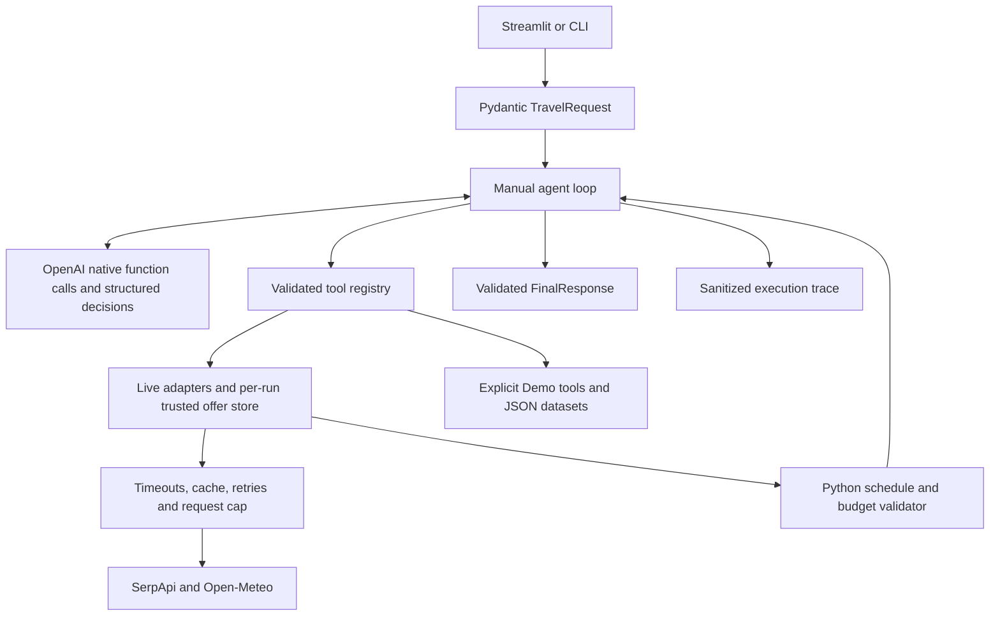
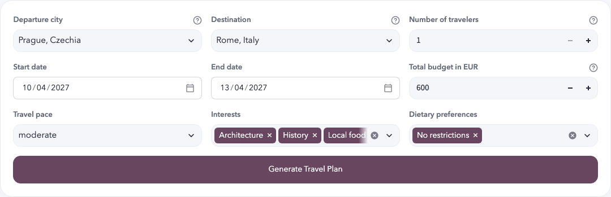
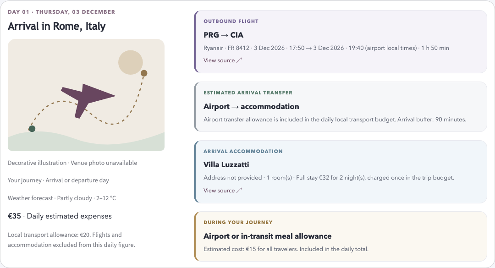
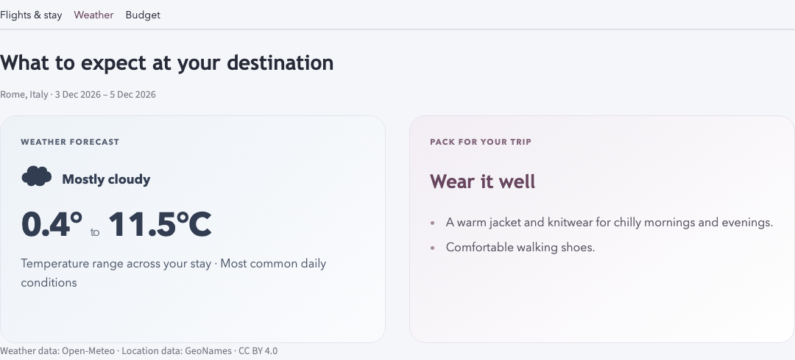
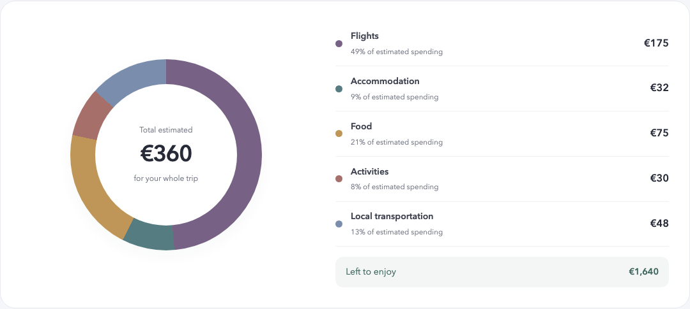

# TripPilot AI

**Your intelligent travel planning assistant**

**Unicorn University · AI for Software Developers · Homework 3 — Agentic Application**

**Option A — Travel-Planner Agent · Author: Natalia Ionova**

TripPilot AI builds day-by-day travel plans from a destination, dates, total budget and preferences. Its OpenAI agent independently chooses tools, searches for travel options and revises unsuccessful plans. Python validates retrieved option IDs, schedules and costs. The application includes a Streamlit interface, an independent CLI, automated tests and two full successful execution traces.


https://github.com/user-attachments/assets/cfc5ea1e-81e4-4655-ae94-b5307068decb


**Live Mode** uses SerpApi for flights, hotels, attractions and restaurants, plus Open-Meteo for weather. **Demo Mode** explicitly uses simulated travel data. Neither mode makes bookings. Prices and availability may change; estimated expenses are labeled.

## Start here: instructor review

1. Follow the setup below, then run `python -m pytest -v`. Tests require no API keys and make no external requests.
2. Run `python verify_submission.py` to inspect the two submitted successful Live traces without spending API credits.
3. Read [agent.py](agent.py) for the explicit loop, [tools/registry.py](tools/registry.py) for native function definitions/dispatch, and [schemas.py](schemas.py) for typed contracts.
4. Read [the two-run walkthrough](docs/DEMONSTRATIONS.md) for actual actions, recoverable errors and independently checked costs.
5. To try a new AI-generated plan, configure your own keys and launch `streamlit run app.py` or use the CLI examples.

| Assignment requirement | Evidence |
| --- | --- |
| Destination, dates, budget and pace/interests/dietary preferences | `TravelRequest` in [schemas.py](schemas.py); form in [app.py](app.py) |
| Explicit agent loop; autonomous tool selection | `TravelAgent._run` in [agent.py](agent.py) |
| Native tool calling and structured outputs | OpenAI Chat Completions function calls + strict JSON-schema decision; Pydantic validation |
| At least four tools, including itinerary assembly | Six Live tools; five preserved Demo tools, described below |
| Tool errors, replanning or clarification | Paris `no_priced_hotels` → broader search; Rome `pace_limit` → revised schedule |
| Day-by-day itinerary and programmatic budget checks | [providers/itinerary.py](providers/itinerary.py), [providers/arrange.py](providers/arrange.py), [budgeting.py](budgeting.py) |
| Clean termination | Five typed terminal statuses, bounded iterations/retries/repeated calls |
| Two complete successful traces | [Rome](traces/20261124T205633_19e1ba5b-0276-4169-b7f3-4944c8c82099.json), [Paris](traces/20261124T205633_30127e40-3f4e-4b19-9f70-b3131cb94ac1.json) |
| Setup, architecture and examples | This README, [examples/](examples), [.env.example](.env.example) |

## Setup

Requires **Python 3.11+**. Verification was performed on macOS with Python 3.14; the installed dependency snapshot is [requirements-tested.txt](requirements-tested.txt). Use [requirements.txt](requirements.txt) for normal installation.

```bash
git clone https://github.com/02ionova/TripPilot.git
cd TripPilot
python3 -m venv .venv
source .venv/bin/activate
python -m pip install -r requirements.txt
```

On Windows PowerShell, create/activate the environment with:

```powershell
py -3 -m venv .venv
.venv\Scripts\Activate.ps1
python -m pip install -r requirements.txt
```

For interactive agent runs, copy `.env.example` to `.env` **only if `.env` does not already exist** (`cp .env.example .env` on macOS/Linux; `Copy-Item .env.example .env` on PowerShell). Fill in your own keys:

```env
OPENAI_API_KEY=
OPENAI_MODEL=gpt-4.1-mini
SERPAPI_API_KEY=
MAX_AGENT_ITERATIONS=15
MAX_SERPAPI_REQUESTS_PER_RUN=15
DATA_MODE=live
ENABLE_AI_FALLBACK=true
```

| Setting | Purpose |
| --- | --- |
| `OPENAI_API_KEY` | Required for real agent runs in either mode; not needed by mocked tests or saved-trace verification |
| `OPENAI_MODEL` | Configurable model; must support Chat Completions native function calling and strict JSON-schema output in your API project |
| `SERPAPI_API_KEY` | One key for all Live searches; create a [SerpApi account](https://serpapi.com/users/sign_up) and copy the key from its dashboard |
| `MAX_AGENT_ITERATIONS` | Maximum planning iterations, default 15 |
| `MAX_SERPAPI_REQUESTS_PER_RUN` | Search-attempt cap, default 15, including retries/airport lookups/return selections/pages |
| `DATA_MODE` | `live` by default; `demo` explicitly selects simulation |
| `ENABLE_AI_FALLBACK` | Optional separate, unverified AI advice after unresolved Live search failures |

The submitted runs used `gpt-4.1-mini`. Do not assume that any model name is compatible: this implementation uses **Chat Completions**, not Responses API. Existing exported environment variables take precedence over `.env`; restart the application after changing configuration. Open-Meteo needs no key. OpenAI API usage is billed separately from SerpApi; no subscription changes are performed. Never commit `.env`.

## Run the application

### Web interface

```bash
streamlit run app.py
```

Open the displayed localhost URL. Use the top toggle for Live/Demo Mode; its help explains the difference. Enter any supported city, preferably **City, Country**, using searchable suggestions or a custom value. Supply dates, budget for **all travelers**, traveler count, pace, interests and dietary preferences. Supported diets are unrestricted, vegetarian, vegan, gluten-free and halal.

Only **Generate Travel Plan** starts planning; Enter does not submit a trip. Dates must not be in the past, must lie in **2026–2027**, and may span **1–14 days**. Adding/removing one traveler adjusts the editable budget by EUR 500; budget buttons use EUR 100 steps and manual values are accepted.

The main result shows daily visits, meals, flight segments, stay and transfer allowances. Supporting tabs show flights/accommodation, two weather/clothing cards and a budget donut with itemized spending. A floating **i** control contains assumptions and practical notes. **Download full report** exports the result and diagnostics together; no inline technical log is required to use the application.

### Command line

```bash
# Live examples used by the submitted genuine runs
python main.py --mode live --input examples/live_rome.json --output results/live_rome.json
python main.py --mode live --input examples/live_paris.json --demonstrate-recovery --output results/live_paris.json

# Original simulated course-style examples
python main.py --mode demo --input examples/rome.json
python main.py --mode demo --input examples/paris.json --demonstrate-recovery
```

The Live examples use **3–5 December 2026**. Update their dates before reuse once the departure date has passed. New prices, search results and model decisions can differ. `--demonstrate-recovery` explicitly requests an initially restrictive hotel filter for a teaching demonstration; it is not enabled in ordinary planning.

The CLI prints the trip/budget, saves final JSON in `results/` and always records a normal completed run in `traces/`, including structured failures. Exit codes: **0** success, **2** invalid input or clarification, **1** other terminal failure. Demo Mode still uses a real OpenAI agent interactively; only its travel data is simulated. Missing provider keys never silently switch Live Mode to Demo Mode.

## Input and structured output

Example input from [examples/rome.json](examples/rome.json), suitable for explicit Demo Mode:

```json
{
  "origin": "Prague",
  "destination": "Rome",
  "start_date": "2027-04-10",
  "end_date": "2027-04-13",
  "budget": 600,
  "travelers": 1,
  "pace": "moderate",
  "interests": ["architecture", "museums", "history", "local food"],
  "dietary_preferences": []
}
```

Pydantic validates required/nonempty fields, finite positive budgets, 1–20 travelers, supported dates/duration and preferences. Ambiguous locations return clarification rather than selecting a different country silently.

`FinalDecision` constrains the model's terminal status/message. Python creates the authoritative `FinalResponse` from a validated builder result. A successful `itinerary` contains the trip summary, selected flights/accommodation, weather, daily schedule, cost items, budget breakdown, recommendations and warnings. Daily entries contain dates, start/end times, places, meals, costs and practical notes. Full typed models are in [schemas.py](schemas.py).

Actual budget excerpt from the submitted Rome Live result (not a complete response schema):

```json
{
  "status": "success",
  "data_source": "live",
  "itinerary": {
    "budget_breakdown": {
      "flights": 175,
      "accommodation": 32,
      "food": 75,
      "activities": 30,
      "local_transport": 48,
      "total": 360,
      "remaining_budget": 1640
    }
  }
}
```

See the full [Rome trace](traces/20261124T205633_19e1ba5b-0276-4169-b7f3-4944c8c82099.json) for the remaining fields. Human-facing dates/money are formatted for readability; JSON retains ISO dates and numeric amounts.

## Architecture and explicit agent loop

Stack: Python, OpenAI Python SDK, Pydantic, Streamlit, python-dotenv, httpx, SQLite/JSON and pytest. **No LangChain, LangGraph, CrewAI or other orchestration framework.**



The explicit `for iteration in range(...)` loop is in `TravelAgent._run` in [agent.py](agent.py):

1. Send the conversation and native function schemas to OpenAI.
2. Preserve the assistant's full tool-call message, including call IDs.
3. Validate and dispatch each selected tool safely; append the result/error with its matching call ID.
4. Let the model choose another search, changed arguments, revised plan or a structured terminal decision.
5. Accept success only after every required tool has succeeded and `build_itinerary` has returned a validated plan. A model's text claim cannot establish success.

The order of searches is **not hardcoded**. In Live Mode, the model selects retrieved flight/hotel IDs and attractions by date. The default `auto_schedule=true` builder uses bounded Python constraint search to place visits/meals around flight windows, known opening intervals and estimated transfers. With `auto_schedule=false`, proposed times are checked strictly. Either path returns actionable errors for the agent to resolve.

## Tools and providers

| Tool | Live source | Responsibility |
| --- | --- | --- |
| `get_weather` | Open-Meteo geocoding, forecast and archive | Coordinates, daily temperatures/conditions/wind/rain; distant dates use a clearly labeled three-season **Historical climate estimate**, not a forecast |
| `search_flights` | SerpApi Google Flights + autocomplete | Resolve city/airport IDs, compare complete round trips and preserve both directions, times, airlines, stops, party prices and search links |
| `search_hotels` | SerpApi Google Hotels | Guest/date-specific stay quotes, nights/rooms, ratings, taxes when supplied, photos and links |
| `search_activities` | SerpApi Google Maps | Real attractions matching interests; location, ratings, hours and entry prices when supplied |
| `search_restaurants` | SerpApi Google Maps | Real meal suggestions with dietary search indications and geographic context; dietary suitability remains subject to confirmation |
| `build_itinerary` | Python, no HTTP | Trusted IDs, schedules, meals, pace, weather, geographic transfer gaps, cost arithmetic and budget validation |

Independent Demo implementations preserve all five original assignment tools and deterministic European mock datasets. Local JSON is never a Live travel-data fallback; the offline city list is only an input convenience.

## Budget policy and uncertainty

All amounts are EUR for the whole party. Python uses Decimal for cost sums and checks, including flights, accommodation, food, activities and local transportation. Flights/accommodation are charged once; daily figures exclude those trip-level costs. Meals are charged once per scheduled meal; travel-only days can use explicit meal allowances.

**Budget policy:** the planner prefers the original target. At the user's request, the application also allows a clearly disclosed alternative up to **10% above** that target. Python rejects larger totals, preserves the original budget and shows any overrun explicitly. This is an application extension to strict-budget planning. **Both submitted successful demonstrations are within their original budgets**, without using the extra allowance.

**Retrieved price** means a provider supplied a usable quote. **Estimated cost** is a planning allowance or derived estimate, never a confirmed offer:

- Flights use the complete return-selection quote for all travelers; an outbound preview is not counted again. Unquoted baggage/ancillary charges remain unknown.
- Hotels prefer the retrieved stay total and tax information. A nightly-only rate is multiplied by nights and marked estimated. For groups over two, the app multiplies a quote for up to two adults per room by `ceil(travelers / 2)`; this is an estimated multiroom total, not confirmed room inventory. All travelers are treated as adults.
- Meals use provider price-tier estimates or a default EUR 15/person/meal. Missing admission prices use a labeled EUR 15/person allowance; unknown hours are not invented.
- Local transport defaults to EUR 8/person/day plus EUR 12/person per airport leg. Transfers use distance estimates, not real routing/timetables. Policies are centralized in [config.py](config.py).

A validated plan is an estimated itinerary, not a reservation, guaranteed bill or proof of the cheapest possible trip.

## Error handling, termination and request limits

Invalid tool arguments, unknown tools, no results, missing prices, ambiguous cities, unsupported directions, timeouts, quota/authentication errors and invalid/over-budget schedules return structured feedback. The agent can replan or ask for clarification. Terminal statuses are `success`, `needs_clarification`, `infeasible`, `error` and `iteration_limit`.

- Planning stops at the configured iteration limit; identical tool calls are bounded.
- Transient OpenAI errors allow at most three attempts; provider requests use a 25-second timeout and at most two transient attempts. Authentication/quota failures are not repeatedly retried.
- Every SerpApi search attempt counts toward the per-run cap, including airport autocomplete, return-flight selections and extra pages. Account API checks are counted separately.
- Identical requests reuse per-run results and an ignored SQLite TTL cache. SerpApi results are cached for one hour; geocoding seven days, forecasts one hour and historical weather one day. Cache keys isolate different SerpApi credentials. The builder makes no provider requests.

The optional AI backup makes at most one separate OpenAI request after an unresolved Live travel-search failure. It shows **unverified general-knowledge suggestions**, model/time/token statistics and verification steps. It cannot invent retrieved offers, claim budget validation or turn a failed plan into `success`. It uses zero additional SerpApi searches; disable with `ENABLE_AI_FALLBACK=false`.

## Execution traces and submitted runs

Every normal agent run saves a timestamped JSON file under `traces/`: run ID, request, model, iterations, assistant/tool messages, call IDs, arguments/results, provider sources/times, errors/replanning/retries, durations/token usage, request counters, final response/status and budget validation. Only observable actions are recorded. **Hidden chain-of-thought is neither requested nor stored.** Keys, authorization fields and credential-bearing URL parameters are redacted.

| Genuine Live run, 24 November 2026 | Final total / original budget | Iterations | Recovery |
| --- | --- | --- | --- |
| [Rome full trace](traces/20261124T205633_19e1ba5b-0276-4169-b7f3-4944c8c82099.json) | EUR 360 / 2,000 | 8 | `pace_limit` → revised daily selection |
| [Paris full trace](traces/20261124T205633_30127e40-3f4e-4b19-9f70-b3131cb94ac1.json) | EUR 455 / 2,000 | 8 | `no_priced_hotels` → broader hotel search |

Both used the real OpenAI API and all six Live tools. Warm-cache search counts were three for Rome and two for Paris; cached responses came from earlier actual provider requests. The recovery filter was explicitly enabled for the Paris demonstration. See [docs/DEMONSTRATIONS.md](docs/DEMONSTRATIONS.md) for the full action sequence, costs and reproduction notes.

Older genuine traces with simulated tools are historical **Demo** runs. Files in `tests/artifacts/` are explicitly **mocked test artifacts**. Neither is presented as Live evidence. `verify_submission.py` checks only the two specified Live traces locally; it does not claim to check today's availability.

The bottom report ZIP includes readable `README.md`, `result.json`, `request.json`, `execution_trace.json`, `runtime.log`, `information.json` and `budget_validation.json`; it adds `ai_fallback.json` if a backup was attempted. Traces/exports can contain travel preferences even after credential redaction; review before sharing.

## Screenshots

Actual browser captures of the application. Result views render the saved genuine Rome Live response; they are **not new searches or current booking offers**. Decorative day illustrations are labeled when venue photos are unavailable.

| Input form | Daily itinerary |
| --- | --- |
|  |  |

| Weather and packing guidance | Budget overview |
| --- | --- |
|  |  |

## Project structure

```text
TripPilot/
├── app.py, ui.py, overview.py       # Form, itinerary, weather and spending views
├── design.py, display.py            # Styling and readable dates/money
├── main.py                         # Independent CLI
├── agent.py, prompts.py             # Explicit loop and system prompts
├── schemas.py, config.py            # Typed contracts and environment settings
├── budgeting.py, tracing.py         # Budget policy and sanitized execution traces
├── fallback.py                     # Separate unverified AI backup response
├── information.py, reporting.py     # Practical notes and full report ZIP
├── verify_submission.py            # Offline verification of submitted evidence
├── providers/                      # Live HTTP/cache, adapters and schedule/budget builder
├── tools/                          # Native schemas, dispatch and Demo tools
├── data/, assets/                   # Demo data, city suggestions, decorative SVGs
├── examples/, traces/               # Inputs and selected genuine execution traces
├── tests/                          # Mocked SDK/HTTP, tool/agent/UI regressions
├── docs/                           # Demonstration walkthrough and screenshots
├── .streamlit/config.toml           # Light theme
├── .env.example, .gitignore
├── requirements.txt, requirements-tested.txt
└── README.md, VERIFICATION.md
```

## Tests and verification

```bash
python -m pytest -v
python verify_submission.py
python -m pip check
```

**209 automated tests passed** in the latest full application check. Tests use scripted SDK responses and mocked HTTP transports, with a guard against accidental external HTTP. They consume **zero API credits**. Coverage includes input/year validation, all tools, round-trip/group pricing, nights/rooms, dietary filtering/uncertainty, weather/archive interpretation, opening hours, overlaps/transfers, trusted IDs, budgets/overruns, cache/quotas/retries, full tool-call recovery, clean termination, structured outputs, traces/secret redaction, backup responses and Streamlit rendering.

[VERIFICATION.md](VERIFICATION.md) records actual environment, earlier integration checks and subsequent regressions. Documentation/screenshot preparation reuses saved data and does not require new paid demonstrations.

## Limitations and future improvements

External coverage, prices and hours can be incomplete/stale. Only known parseable closures can be enforced. Dietary indications do not certify allergy safety or halal compliance. Historical climate uses a small three-season sample, not a long-term climate normal or a prediction. No reservations, child fares, guaranteed multiroom inventory, verified public-transport routing or baggage-fee validation are implemented. API latency depends on the number of searches, model turns, retries and cache state.

Weather attribution: [Open-Meteo](https://open-meteo.com/), [CC BY 4.0](https://creativecommons.org/licenses/by/4.0/); location data: [GeoNames](https://www.geonames.org/). Live search integrations follow the official [Flights](https://serpapi.com/google-flights-api), [Hotels](https://serpapi.com/google-hotels-api), [Maps](https://serpapi.com/google-maps-api), [Search](https://serpapi.com/search-api) and [Account](https://serpapi.com/account-api) interfaces. Observe provider terms and noncommercial/free-service limitations before reuse. `.env`, caches, virtual environments and temporary results are ignored by Git; selected reviewed demonstration traces are intentionally included.

Potential improvements: verified routes and seasonal/holiday hours, direct inventory checks, independently sourced admission prices, stronger model evaluation and a longer climate baseline. Preserve independent Python validation and explicit price uncertainty.
